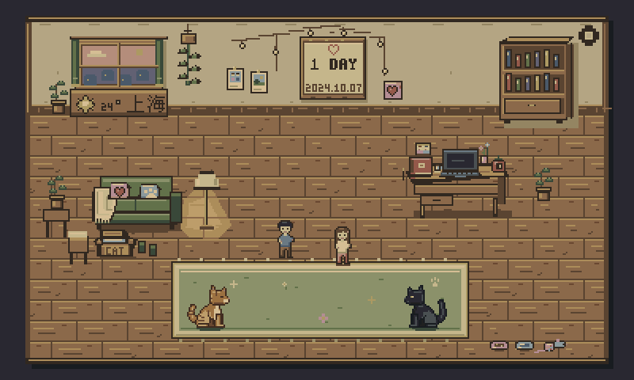

# CatDesk

送给一个人的双猫像素桌面陪伴屏。原创黄昏房间、橘猫和黑猫、触摸爱心、2024.10.07 纪念日，以及 2026.10.07 的双猫两周年动画。

本仓库包含 ESP32-S3 固件、macOS Helper、预览生成器和实机固件归档。原始代码、原创图像与脚本按 [MIT License](LICENSE) 发布；WenQuanYi 中文点阵字、Waveshare 参考代码等第三方内容继续遵循各自许可，见 [第三方说明](THIRD_PARTY_NOTICES.md)。

**2026-10-06 情侣随机走动修正版已编译、烧录。** 进入房间即可看见两位原创 16×24 NPC，每人 9 色，两帧轻量步态；在家具之间的空地随机走几步、停一会儿。新增情侣相框与点击效果已移除。保留至少 20min 间隔的低频沙发 8–15s 坐姿，以及原周年后的 2.5s“两个人、两只猫与 2024.10.07”结尾。两只猫仍是主要陪伴角色。[随机走动软件预览](assets/couple-walk-2026-10-06/couple_walk.gif)、[入口画面](assets/couple-walk-2026-10-06/couple_walk_entry.png)、[当前固件](releases/couple-walk-2026-10-06/catdesk-couple-walk.bin)。实机验收边界见[进度记录](CATDESK_PROGRESS.md)。

**2026-10-06 Welcome 版本已编译、烧录，并经用户实机确认等待触摸 → 进入主页正常。** 开机先看见夜蓝色中的原创小屋，窗户点亮后双猫跑到“欢迎回家”木牌下；4 秒后静止等候，触摸一次再跑进暖光门口，用 0.8 秒像素方块过渡进入房间。10 月 7 日增加“♡ 两周年快乐 ♡”与三颗小爱心。[开机动画软件预览](assets/welcome-2026-10-06/welcome_normal_preview.gif)、[周年版本预览](assets/welcome-2026-10-06/welcome_anniversary_preview.gif)、[当前已烧录固件](releases/welcome-2026-10-06/catdesk-welcome.bin)。

Welcome 版本包含已有的昼夜与八种猫生活行为候选源码；原实机礼物版保留作回退。[昼夜预览](assets/candidate-2026-10-06/room_periods_preview.png)、[完整五分钟猫生活预览](assets/candidate-2026-10-06/room_life_preview.gif)、[不含 Welcome 的原候选固件](releases/candidate-2026-10-06/catdesk-room-candidate.bin)。房间生活候选功能的 1–2 小时实机连续运行验收仍待完成，详见[开发进度](CATDESK_PROGRESS.md)。



Waveshare ESP32-S3-Touch-LCD-7 / PCB Rev1.2 / ESP32-S3N16R8，ESP-IDF v5.5.5 + LVGL 9。400×240 逻辑像素以整数 2× 显示在 800×480 屏幕；无抗锯齿、PNG 解码或 alpha 特效。现有 LCD/GT911 初始化、引脚、Flash 参数、分区和 Bootloader 保持原样。

点击房间里的相框、窗户、便签本、番茄钟、小电脑或齿轮打开对应像素弹窗。猫会走动、眨眼和睡觉；点击有专属反应，连续点击五次出现“喵？”。

当前版本采用短北墙、大片木地板、三分之四视角家具和约 26 px 高的宠物 NPC。功能由小窗户、相框、笔记本、番茄钟与 MacBook 进入。菜单重新绘制为实木厚框、铆钉、纸纤维和双页任务本，字体使用原创 bitmap 与 3×5 家具微字。两周年时房间按离散夜色变暗、双猫靠近并显示剧情卷轴。

[去掉全部文字的世界图](assets/world_preview.png)可用来检查场景本身的 RPG 构图与比例；[原始同源主页图](assets/home_preview.png)保留功能信息。世界和菜单共用 29 色，所有资产原创。

- 本地功能：最多五项预设待办、勾选和新增、25 分钟专注/暂停/继续/重置、亮度及待办保存。
- 天气目前为上海示例数据；Mac 未连接时显示明确标注的示例数据。
- [Mac Helper](helper/README.md)自动确认设备身份、同步时间及真实电脑信息，支持 macOS 15+。
- [两周年动画](assets/anniversary_preview.gif)、[猫咪互动](assets/cats_live_preview.gif)、[弹窗预览](assets/popups_preview.png)均由实际固件渲染器生成。

构建与检查：

先安装 ESP-IDF v5.5.5，并递归克隆板级支持子模块：

```sh
git clone --recurse-submodules https://github.com/zxingchen77/catdesk.git
cd catdesk
```

```sh
source ~/esp/esp-idf-v5.5.5/export.sh
cd firmware
idf.py build
idf.py -p /dev/cu.wchusbserial… app-flash
```

烧录使用 `app-flash`，只写应用分区。先退出 Helper，握手失败最多尝试两次；不运行 erase-flash。

```sh
sh tools/check.sh
python3 tools/generate_previews.py
python3 tools/generate_welcome_previews.py
python3 tools/generate_couple_previews.py
```

Helper 的虚拟串口协议及断线重连检查（先退出已运行的 Helper）：

```sh
python3 helper/test_helper.py
python3 helper/test_reconnect.py
```

当前源码、实机检查结果与人工验收边界见 [开发进度](CATDESK_PROGRESS.md)；与实际烧录一致的固件及 SHA-256 位于 [releases](releases/README.md)。

屏幕亮度为软件 RGB565 调暗，保持当前背光硬件配置；没有音量入口。完全断电时没有可靠离线时钟，开机连接运行中的 Helper 可校准日期；持续供电则会自动跨午夜触发周年。中文点阵字来源和嵌入许可见 [字体许可](docs/font-license.md)。
